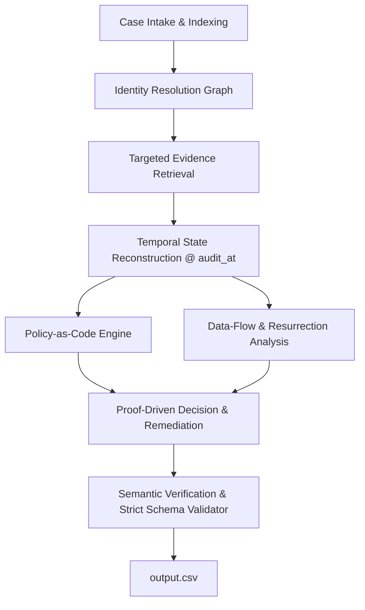

# Tracepoint: Architecture & Engineering Blueprint

## 1. System Mission & Core Objective

**Tracepoint** is an evidence-grounded deletion auditing system built for Northstar Shop in the HackerRank Orchestrate challenge (*Ghost Data Still Exists*).

The core challenge addresses a critical enterprise failure mode: internal dashboards report a deletion request as **"Complete"**, yet personal data persists in read replicas, search indexes, analytics profiles, support logs, exports, archives, or backups. Furthermore, active synchronization pipelines or backup restoration jobs can recreate data that was previously removed.

Tracepoint audits all 518 evaluation deletion cases, reconstructing the ground truth state at each case's `audit_at` timestamp using participant-facing evidence. It deterministically classifies each case into one of three statuses:
- **`COMPLETE`**: Sufficient evidence proves that every applicable deletion, redaction, anonymization, and retention requirement has been satisfied, and no active recreation paths exist. Contains only evidence-backed verification checks.
- **`INCOMPLETE`**: Evidence reveals residual records, exposed PII, active sync flows, or restore risks. Produces an ordered remediation plan and future verification checks.
- **`NOT_APPLICABLE`**: The person did not authorize deletion (e.g., submitted an access request, billing copy request, marketing opt-out, or profile correction). Contains `steps_json: []`.

---

## 2. Architecture Strategy: Hybrid Evidence-First (Option C)

Based on the *Northstar Shop Engineering Differentiation Blueprint*, Tracepoint follows a **Hybrid Evidence-First Architecture**:

### Core Architectural Layers:
1. **Intelligence Layer**: Resolves ambiguous request texts, multi-language intents, and unstructured documents without accepting claims as proof.
2. **Evidence Engineering Layer**: Tracks provenance-aware identity links, temporal resource lifecycles through `audit_at`, and contradiction detection.
3. **Decision Engineering Layer**: Applies policy-as-code, explicit proof conditions, dependency-aware remediation ordering, and post-generation semantic verification.

---

## 3. The Eight Engineering Stages

| Stage | Responsibility | Primary Output |
|---|---|---|
| **1. Intake & Indexing** | Ingest all tabular datasets, index evidence metadata, validate schemas, preserve immutability. | Case index & Evidence catalog |
| **2. Identity Resolution** | Link current emails, historical emails (`user_audit_log.csv`), names, phones, and SHA-256 hashes without false merges. | Provenance-aware Identity Graph |
| **3. Evidence Extraction** | Query SQLite SQL dumps, parse structured JSON, scan plaintext logs, extract document text and console images. | Case-relevant Evidence Records |
| **4. Temporal Reconstruction** | Order events chronologically; evaluate resource state strictly at or before `audit_at`; discard post-audit data. | Timeline & Resource State Ledger |
| **5. Policy-as-Code** | Enforce 15 rules from `deletion_rules.csv` (DELETE, REDACT, ANONYMIZE, RETAIN, TOMBSTONE). | Machine-readable Policy Decisions |
| **6. Flow & Restoration Analysis** | Detect active sync pipelines, replication drift, and restorable backups that threaten data resurrection. | Resurrection Risk Graph |
| **7. Decision & Remediation** | Synthesize findings; generate ordered remediation (flows disabled before records changed); produce verification checks. | Audit Findings & Step Sequence |
| **8. Semantic Output Validation** | Verify strict JSON schema, consecutive step numbering, phase order, allowed operation/state pairs, and evidence IDs. | Evaluated & Formatted `output.csv` |

---

## 4. Verified Dataset Baseline & Ground Truth Metrics

Inspection of the supplied dataset in Phase 1 established the following verified invariants:

* **Tabular Datasets (All 0 Nulls, 0 Duplicates):**
  * `deletion_requests.csv`: 518 evaluation requests (`case_33` to `case_550`).
  * `sample_deletion_requests.csv`: 32 sample requests (`case_01` to `case_32`).
  * `sample_output.csv`: 32 canonical answer rows demonstrating correct decision logic and JSON serialization.
  * `user_identities.csv`: 850 active user profiles (850 unique `user_id`, 850 unique `email`).
  * `user_audit_log.csv`: 306 historical audit events tracking field updates (107 unique historical email changes).
  * `system_activity.csv`: 4,011 system activity events across services and databases.
  * `deletion_rules.csv`: 15 explicit policy rules defining required treatments.
  * `evidence_files.csv`: 94 evidence files declared in manifest.
* **Evidence Repository (94/94 Files Accounted For):**
  * 24 SQL database snapshots (`evidence/databases/*.sql`)
  * 28 JSON snapshot bundles (`evidence/records/*.json`)
  * 26 Application and syslog traces (`evidence/logs/*.log`)
  * 11 Admin and portal console captures (`evidence/images/*.png`)
  * 4 Reports and legal registers (`evidence/documents/*.pdf`)
  * 1 Handover document (`evidence/records/*.txt`)
* **Identity Resolution Coverage:**
  * Sample requests (32): 29 matched current email, 3 matched historical audit email only = **100% resolved**.
  * Evaluation requests (518): 417 matched current email, 101 matched historical audit email only = **100% resolved**.
* **Intent Classification Finding:**
  * Evaluation cases `case_533` through `case_542` contain explicit non-deletion requests (e.g., login reset, invoice copy, marketing opt-out, phone update). These are candidates for `NOT_APPLICABLE` with `steps_json: []`.

---

## 5. Decision & Output Rules

### Allowed Phases & Sequence:
1. `FINDING`
2. `REMEDIATION`
3. `VERIFICATION`

### Permitted Operation / State Pairs:
* **FINDING**:
  * `REPORT_REMAINING_RECORD` -> `PRESENT`
  * `REPORT_EXPOSED_PII` -> `PRESENT`
  * `REPORT_ACTIVE_DATA_FLOW` -> `ACTIVE`
  * `REPORT_RESTORE_RISK` -> `ACTIVE`
* **REMEDIATION**:
  * `DISABLE_DATA_FLOW` -> `DISABLED`
  * `BLOCK_RESTORE` -> `BLOCKED`
  * `DELETE_RECORD` -> `ABSENT`
  * `REDACT_RECORD` -> `REDACTED`
  * `ANONYMIZE_RECORD` -> `ANONYMIZED`
* **VERIFICATION**:
  * `VERIFY_RECORD_ABSENT` -> `ABSENT`
  * `VERIFY_RECORD_PRESENT` -> `PRESENT`
  * `VERIFY_RECORD_REDACTED` -> `REDACTED`
  * `VERIFY_RECORD_ANONYMIZED` -> `ANONYMIZED`
  * `VERIFY_DATA_FLOW_DISABLED` -> `DISABLED`
  * `VERIFY_RESTORE_BLOCKED` -> `BLOCKED`

### Evidence ID Citation Rules:
* In `COMPLETE` cases: All verification steps must cite valid evidence (`evidence_id` non-empty).
* In `INCOMPLETE` cases: Findings must cite supporting evidence. Proposed remediation and future verification steps must use empty string `evidence_id: ""`.
* In `NOT_APPLICABLE` cases: `steps_json: []`.

---

## 6. Phase 1 Deliverables Summary

1. `code/config.py`: Deterministic project configuration and dataset path resolution.
2. `code/tracepoint/models.py`: Pydantic domain models with strict schema, phase, operation, and state validators.
3. `code/tracepoint/utils.py`: Privacy sanitization functions and ISO-8601 parsers.
4. `code/inspect_dataset.py`: Comprehensive dataset integrity audit script.
5. `tests/`: Pytest test suite covering path resolution, schema validation, evidence matching, and privacy masking (11/11 tests passing).
6. `requirements.txt`: Minimal dependency specification (`pandas`, `pydantic`, `pytest`).
